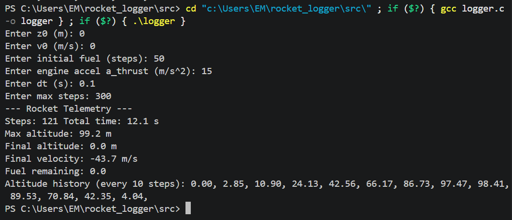
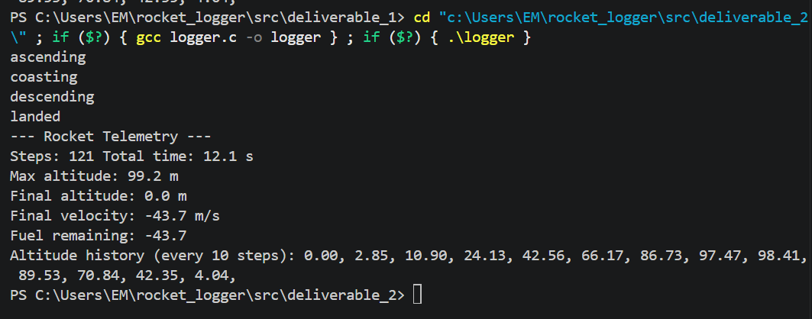

# DELIVERABLE 1
I used the same inputs as the example (z0 = 0, v0 = 0, 50 fuel steps, a_thrust = 15 m/s^2, dt = 0.1 s, max steps = 300). 

50 fuel steps * 0.1 = 5 seconds of fuel

Since a_thrust > g, the rocket lifts off and the fuel burns for 5 seconds. It reaches an apex of about 99.2 m and falls back to the ground. The max step cap of 300 is large enough to cover the full flight, which lands at 121 steps (12.1 s).



# DELIVERABLE 2
I used the same inputs as the example (z0 = 0, v0 = 0, 50 fuel steps, a_thrust = 15 m/s^2, dt = 0.1 s, max steps = 300). This allowed me to verify my results with the previous deliverable.

I added a PRELAUNCH state in run_rocket_state() to check if rocket should be able to lift off, allowing me to keep the loop condition (while state != FLIGHT_LANDED). Then, other states are updated by having a state change condition inside the case statement. That is, if the vehicle is in FLIGHT_ASCENT case, it checks the fuel and velocity to see if it is coasting, then changes to FLIGHT_COASTING. 

update_sensor_sample() is basically the physics logic from the previous deliverable. Timestamp is incremented within.

update_telemetry_state collects values from sensor and updates velocity/altitude.



# DELIVERABLE 3
Holy moly. Anyways we added a ring buffer and scheduler to the logger. I made two push functions (1 to discard newest vs oldest) to accommodate for how the sensor and telemetry handle the buffer differently. The buffer functions also work with universal data types so I don't have to duplicate functions for different packets. The committed task intervals are meant to show parallels to previous deliverables. For example, the landing velocity is ~42.7 m/s, which is the same as in deliverable 1/2. The value is slightly different likely because I started clamping velocity so the print statements wouldn't look odd (altitude 0 but velocity always decreasing).

```bash
Sample sensor task

Sample sensor task

Rocket state running

Sample sensor task

Rocket state running
ascending

Sample sensor task

Sample sensor task

Rocket state running

Sample sensor task

Sample sensor task

Telemetry printing task
t=0.1 s 
   velocity=0.5 m/s     altitude=0.1 m     fuel=49
t=0.2 s 
   velocity=1.0 m/s     altitude=0.2 m     fuel=48
t=0.3 s 
   velocity=1.6 m/s     altitude=0.3 m     fuel=47

Rocket state running

Sample sensor task

Sample sensor task

Sample sensor task

Rocket state running

Sample sensor task

Sample sensor task

Rocket state running

Sample sensor task

Rocket state running

Sample sensor task

Sample sensor task

Telemetry printing task
t=0.4 s 
   velocity=2.1 m/s     altitude=0.5 m     fuel=46
t=0.5 s 
   velocity=2.6 m/s     altitude=0.8 m     fuel=45
t=0.6 s 
   velocity=3.1 m/s     altitude=1.1 m     fuel=44
t=0.7 s 
   velocity=3.6 m/s     altitude=1.5 m     fuel=43
t=0.8 s 
   velocity=4.2 m/s     altitude=1.9 m     fuel=42
t=0.9 s 
   velocity=4.7 m/s     altitude=2.3 m     fuel=41
t=1.0 s 
   velocity=5.2 m/s     altitude=2.9 m     fuel=40
t=1.1 s 
   velocity=5.7 m/s     altitude=3.4 m     fuel=39
t=1.2 s 
   velocity=6.2 m/s     altitude=4.0 m     fuel=38
t=1.3 s 
   velocity=6.7 m/s     altitude=4.7 m     fuel=37
t=1.4 s 
   velocity=7.3 m/s     altitude=5.4 m     fuel=36
t=1.5 s 
   velocity=7.8 m/s     altitude=6.2 m     fuel=35

Rocket state running

Sample sensor task

Sample sensor task

Rocket state running

Sample sensor task

Sample sensor task

Rocket state running

Sample sensor task

Sample sensor task

Rocket state running

Sample sensor task

Sample sensor task

Telemetry printing task
t=1.6 s 
   velocity=8.3 m/s     altitude=7.1 m     fuel=34
t=1.7 s 
   velocity=8.8 m/s     altitude=7.9 m     fuel=33
t=1.8 s 
   velocity=9.3 m/s     altitude=8.9 m     fuel=32
t=1.9 s 
   velocity=9.9 m/s     altitude=9.9 m     fuel=31
t=2.0 s 
   velocity=10.4 m/s     altitude=10.9 m     fuel=30
t=2.1 s 
   velocity=10.9 m/s     altitude=12.0 m     fuel=29
t=2.2 s 
   velocity=11.4 m/s     altitude=13.1 m     fuel=28
t=2.3 s 
   velocity=11.9 m/s     altitude=14.3 m     fuel=27

Rocket state running

Sample sensor task

Sample sensor task

Rocket state running

Sample sensor task

Sample sensor task

Rocket state running

Sample sensor task

Sample sensor task

Rocket state running

Sample sensor task

Sample sensor task

Telemetry printing task
t=2.4 s 
   velocity=12.5 m/s     altitude=15.6 m     fuel=26
t=2.5 s 
   velocity=13.0 m/s     altitude=16.9 m     fuel=25
t=2.6 s 
   velocity=13.5 m/s     altitude=18.2 m     fuel=24
t=2.7 s 
   velocity=14.0 m/s     altitude=19.6 m     fuel=23
t=2.8 s 
   velocity=14.5 m/s     altitude=21.1 m     fuel=22
t=2.9 s 
   velocity=15.1 m/s     altitude=22.6 m     fuel=21
t=3.0 s 
   velocity=15.6 m/s     altitude=24.1 m     fuel=20
t=3.1 s 
   velocity=16.1 m/s     altitude=25.7 m     fuel=19

Rocket state running

Sample sensor task

Sample sensor task

Rocket state running

Sample sensor task

Sample sensor task

Rocket state running

Sample sensor task

Sample sensor task

Rocket state running

Sample sensor task

Sample sensor task

Telemetry printing task
t=3.2 s 
   velocity=16.6 m/s     altitude=27.4 m     fuel=18
t=3.3 s 
   velocity=17.1 m/s     altitude=29.1 m     fuel=17
t=3.4 s 
   velocity=17.6 m/s     altitude=30.9 m     fuel=16
t=3.5 s 
   velocity=18.2 m/s     altitude=32.7 m     fuel=15
t=3.6 s 
   velocity=18.7 m/s     altitude=34.6 m     fuel=14
t=3.7 s 
   velocity=19.2 m/s     altitude=36.5 m     fuel=13
t=3.8 s 
   velocity=19.7 m/s     altitude=38.5 m     fuel=12
t=3.9 s 
   velocity=20.2 m/s     altitude=40.5 m     fuel=11

Rocket state running

Sample sensor task

Sample sensor task

Rocket state running

Sample sensor task

Sample sensor task

Rocket state running

Sample sensor task

Sample sensor task

Rocket state running

Sample sensor task

Sample sensor task

Telemetry printing task
t=4.0 s 
   velocity=20.8 m/s     altitude=42.6 m     fuel=10
t=4.1 s 
   velocity=21.3 m/s     altitude=44.7 m     fuel=9
t=4.2 s 
   velocity=21.8 m/s     altitude=46.9 m     fuel=8
t=4.3 s 
   velocity=22.3 m/s     altitude=49.1 m     fuel=7
t=4.4 s 
   velocity=22.8 m/s     altitude=51.4 m     fuel=6
t=4.5 s 
   velocity=23.4 m/s     altitude=53.7 m     fuel=5
t=4.6 s 
   velocity=23.9 m/s     altitude=56.1 m     fuel=4
t=4.7 s 
   velocity=24.4 m/s     altitude=58.5 m     fuel=3

Rocket state running

Sample sensor task

Sample sensor task

Rocket state running

Sample sensor task

Sample sensor task

Rocket state running
coasting

Sample sensor task

Sample sensor task

Rocket state running

Sample sensor task

Sample sensor task

Telemetry printing task
t=4.8 s 
   velocity=24.9 m/s     altitude=61.0 m     fuel=2
t=4.9 s 
   velocity=25.4 m/s     altitude=63.6 m     fuel=1
t=5.0 s 
   velocity=25.9 m/s     altitude=66.2 m     fuel=0
t=5.1 s 
   velocity=25.0 m/s     altitude=68.7 m     fuel=0
t=5.2 s 
   velocity=24.0 m/s     altitude=71.1 m     fuel=0
t=5.3 s 
   velocity=23.0 m/s     altitude=73.4 m     fuel=0
t=5.4 s 
   velocity=22.0 m/s     altitude=75.6 m     fuel=0
t=5.5 s 
   velocity=21.0 m/s     altitude=77.7 m     fuel=0

Rocket state running

Sample sensor task

Sample sensor task

Rocket state running

Sample sensor task

Sample sensor task

Rocket state running

Sample sensor task

Sample sensor task

Rocket state running

Sample sensor task

Sample sensor task

Telemetry printing task
t=5.6 s 
   velocity=20.1 m/s     altitude=79.7 m     fuel=0
t=5.7 s 
   velocity=19.1 m/s     altitude=81.6 m     fuel=0
t=5.8 s 
   velocity=18.1 m/s     altitude=83.4 m     fuel=0
t=5.9 s 
   velocity=17.1 m/s     altitude=85.1 m     fuel=0
t=6.0 s 
   velocity=16.1 m/s     altitude=86.7 m     fuel=0
t=6.1 s 
   velocity=15.2 m/s     altitude=88.2 m     fuel=0
t=6.2 s 
   velocity=14.2 m/s     altitude=89.7 m     fuel=0
t=6.3 s 
   velocity=13.2 m/s     altitude=91.0 m     fuel=0

Rocket state running

Sample sensor task

Sample sensor task

Rocket state running

Sample sensor task

Sample sensor task

Rocket state running

Sample sensor task

Sample sensor task

Rocket state running

Sample sensor task

Sample sensor task

Telemetry printing task
t=6.4 s 
   velocity=12.2 m/s     altitude=92.2 m     fuel=0
t=6.5 s 
   velocity=11.2 m/s     altitude=93.3 m     fuel=0
t=6.6 s 
   velocity=10.3 m/s     altitude=94.4 m     fuel=0
t=6.7 s 
   velocity=9.3 m/s     altitude=95.3 m     fuel=0
t=6.8 s 
   velocity=8.3 m/s     altitude=96.1 m     fuel=0
t=6.9 s 
   velocity=7.3 m/s     altitude=96.8 m     fuel=0
t=7.0 s 
   velocity=6.3 m/s     altitude=97.5 m     fuel=0
t=7.1 s 
   velocity=5.3 m/s     altitude=98.0 m     fuel=0

Rocket state running

Sample sensor task

Sample sensor task

Rocket state running

Sample sensor task

Sample sensor task

Rocket state running

Sample sensor task

Sample sensor task

Rocket state running

Sample sensor task

Sample sensor task

Telemetry printing task
t=7.2 s 
   velocity=4.4 m/s     altitude=98.4 m     fuel=0
t=7.3 s 
   velocity=3.4 m/s     altitude=98.8 m     fuel=0
t=7.4 s 
   velocity=2.4 m/s     altitude=99.0 m     fuel=0
t=7.5 s 
   velocity=1.4 m/s     altitude=99.2 m     fuel=0
t=7.6 s 
   velocity=0.4 m/s     altitude=99.2 m     fuel=0
t=7.7 s 
   velocity=-0.5 m/s     altitude=99.2 m     fuel=0
t=7.8 s 
   velocity=-1.5 m/s     altitude=99.0 m     fuel=0
t=7.9 s 
   velocity=-2.5 m/s     altitude=98.8 m     fuel=0

Rocket state running
descending

Sample sensor task

Sample sensor task

Rocket state running

Sample sensor task

Sample sensor task

Rocket state running

Sample sensor task

Sample sensor task

Rocket state running

Sample sensor task

Sample sensor task

Telemetry printing task
t=8.0 s 
   velocity=-3.5 m/s     altitude=98.4 m     fuel=0
t=8.1 s 
   velocity=-4.5 m/s     altitude=98.0 m     fuel=0
t=8.2 s 
   velocity=-5.4 m/s     altitude=97.4 m     fuel=0
t=8.3 s 
   velocity=-6.4 m/s     altitude=96.8 m     fuel=0
t=8.4 s 
   velocity=-7.4 m/s     altitude=96.0 m     fuel=0
t=8.5 s 
   velocity=-8.4 m/s     altitude=95.2 m     fuel=0
t=8.6 s 
   velocity=-9.4 m/s     altitude=94.3 m     fuel=0
t=8.7 s 
   velocity=-10.3 m/s     altitude=93.2 m     fuel=0

Rocket state running

Sample sensor task

Sample sensor task

Rocket state running

Sample sensor task

Sample sensor task

Rocket state running

Sample sensor task

Sample sensor task

Rocket state running

Sample sensor task

Sample sensor task

Telemetry printing task
t=8.8 s 
   velocity=-11.3 m/s     altitude=92.1 m     fuel=0
t=8.9 s 
   velocity=-12.3 m/s     altitude=90.9 m     fuel=0
t=9.0 s 
   velocity=-13.3 m/s     altitude=89.5 m     fuel=0
t=9.1 s 
   velocity=-14.3 m/s     altitude=88.1 m     fuel=0
t=9.2 s 
   velocity=-15.3 m/s     altitude=86.6 m     fuel=0
t=9.3 s 
   velocity=-16.2 m/s     altitude=85.0 m     fuel=0
t=9.4 s 
   velocity=-17.2 m/s     altitude=83.2 m     fuel=0
t=9.5 s 
   velocity=-18.2 m/s     altitude=81.4 m     fuel=0

Rocket state running

Sample sensor task

Sample sensor task

Rocket state running

Sample sensor task

Sample sensor task

Rocket state running

Sample sensor task

Sample sensor task

Rocket state running

Sample sensor task

Sample sensor task

Telemetry printing task
t=9.6 s 
   velocity=-19.2 m/s     altitude=79.5 m     fuel=0
t=9.7 s 
   velocity=-20.2 m/s     altitude=77.5 m     fuel=0
t=9.8 s 
   velocity=-21.1 m/s     altitude=75.4 m     fuel=0
t=9.9 s 
   velocity=-22.1 m/s     altitude=73.2 m     fuel=0

Rocket state running

Sample sensor task

Sample sensor task

Rocket state running

Sample sensor task

Sample sensor task

Rocket state running

Sample sensor task

Sample sensor task

Rocket state running

Sample sensor task

Sample sensor task

Telemetry printing task
t=10.0 s 
   velocity=-23.1 m/s     altitude=70.8 m     fuel=0
t=10.1 s 
   velocity=-24.1 m/s     altitude=68.4 m     fuel=0
t=10.2 s 
   velocity=-25.1 m/s     altitude=65.9 m     fuel=0
t=10.3 s 
   velocity=-26.0 m/s     altitude=63.3 m     fuel=0
t=10.4 s 
   velocity=-27.0 m/s     altitude=60.6 m     fuel=0
t=10.5 s 
   velocity=-28.0 m/s     altitude=57.8 m     fuel=0
t=10.6 s 
   velocity=-29.0 m/s     altitude=54.9 m     fuel=0
t=10.7 s 
   velocity=-30.0 m/s     altitude=51.9 m     fuel=0

Rocket state running

Sample sensor task

Sample sensor task

Rocket state running

Sample sensor task

Sample sensor task

Rocket state running

Sample sensor task

Sample sensor task

Rocket state running

Sample sensor task

Sample sensor task

Telemetry printing task
t=10.8 s 
   velocity=-30.9 m/s     altitude=48.8 m     fuel=0
t=10.9 s 
   velocity=-31.9 m/s     altitude=45.6 m     fuel=0
t=11.0 s 
   velocity=-32.9 m/s     altitude=42.3 m     fuel=0
t=11.1 s 
   velocity=-33.9 m/s     altitude=39.0 m     fuel=0
t=11.2 s 
   velocity=-34.9 m/s     altitude=35.5 m     fuel=0
t=11.3 s 
   velocity=-35.9 m/s     altitude=31.9 m     fuel=0
t=11.4 s 
   velocity=-36.8 m/s     altitude=28.2 m     fuel=0
t=11.5 s 
   velocity=-37.8 m/s     altitude=24.4 m     fuel=0
t=11.6 s 
   velocity=-38.8 m/s     altitude=20.5 m     fuel=0
t=11.7 s 
   velocity=-39.8 m/s     altitude=16.6 m     fuel=0
t=11.8 s 
   velocity=-40.8 m/s     altitude=12.5 m     fuel=0
t=11.9 s 
   velocity=-41.7 m/s     altitude=8.3 m     fuel=0

Rocket state running

Sample sensor task

Sample sensor task

Rocket state running

Sample sensor task

Sample sensor task

Rocket state running
landed

Sample sensor task

Sample sensor task

Rocket state running

Sample sensor task

Sample sensor task

Telemetry printing task
t=12.0 s 
   velocity=-42.7 m/s     altitude=4.0 m     fuel=0
t=12.1 s 
   velocity=0.0 m/s     altitude=0.0 m     fuel=0
t=12.2 s 
   velocity=0.0 m/s     altitude=0.0 m     fuel=0
t=12.3 s 
   velocity=0.0 m/s     altitude=0.0 m     fuel=0
t=12.4 s 
   velocity=0.0 m/s     altitude=0.0 m     fuel=0
t=12.5 s 
   velocity=0.0 m/s     altitude=0.0 m     fuel=0
t=12.6 s 
   velocity=0.0 m/s     altitude=0.0 m     fuel=0
t=12.7 s 
   velocity=0.0 m/s     altitude=0.0 m     fuel=0

Rocket state running

Sample sensor task

Sample sensor task

Rocket state running

Sample sensor task

Sample sensor task
```